# Olist E-Commerce Analysis: Sales Performance & Customer Experience


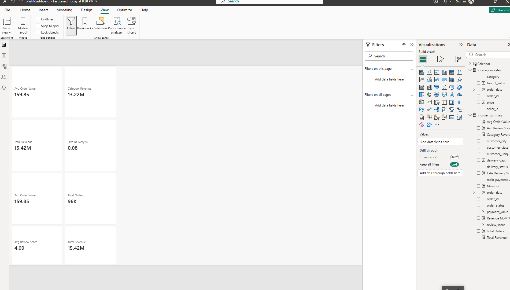
*Power BI KPI cards built on the validated reporting layer.*

## Executive Summary

This project analyzes **~100,000 orders** from Olist, a Brazilian e-commerce marketplace
(2016–2018), to understand what drives revenue and customer satisfaction. I modeled the
raw data in **PostgreSQL**, answered ten business questions with **SQL**, and built an
interactive **Power BI** dashboard on top of a validated reporting layer.

**Headline finding:** late deliveries are the main driver of poor customer satisfaction.
Orders delivered late average **2.57★**, compared with **4.29★** for on-time orders, which is
**40% lower**. Combined with a **3.0% repeat-purchase rate**, this points to delivery
reliability and customer retention as the two highest-impact areas for improvement.

---

## Table of Contents
1. [Business Problem](#business-problem)
2. [Dataset](#dataset)
3. [Tools & Skills](#tools--skills)
4. [Methodology](#methodology)
5. [Key Results](#key-results)
6. [Recommendations](#recommendations)
7. [Dashboard](#dashboard)
8. [Limitations](#limitations)

---

## Business Problem

The leadership of an online marketplace needs clear answers to five questions:

| # | Question | Why it matters |
|---|---|---|
| 1 | How large is the business, and how is revenue trending? | Baseline performance and growth tracking |
| 2 | Which product categories and regions drive revenue? | Inventory and marketing allocation |
| 3 | Does delivery performance affect customer satisfaction? | Logistics investment decisions |
| 4 | How many customers make repeat purchases? | Retention strategy |
| 5 | How and when do customers buy? | Checkout design and campaign timing |

## Dataset

- **Source:** [Brazilian E-Commerce Public Dataset by Olist](https://www.kaggle.com/datasets/olistbr/brazilian-ecommerce) (Kaggle)
- **Scope:** ~99K orders, ~112K order items, ~93K unique customers, ~33K products, ~3K sellers
- **Period:** September 2016 – October 2018
- **Structure:** 8 relational tables linked by `order_id`, `customer_id`, `product_id` and `seller_id`
- **Currency:** Brazilian Real (R$)

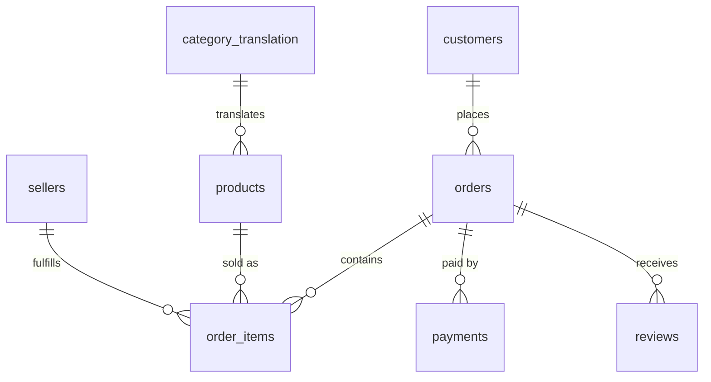

## Tools & Skills

| Area | Tools / Techniques |
|---|---|
| Database | PostgreSQL 18, pgAdmin 4, psql (`\copy` bulk import) |
| SQL | Multi-table JOINs, CTEs, window functions (`LAG`, `RANK`, `SUM() OVER`), `CASE` logic, date arithmetic, views |
| Data quality | Null and duplicate checks, grain definition, fan-out prevention |
| BI & modeling | Power BI, star schema, date table, DAX (`CALCULATE`, `DIVIDE`, `DATEADD`, variables) |
| Validation | Reconciled dashboard KPIs against SQL outputs |

---

## Methodology

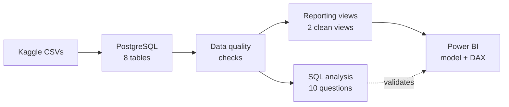

### 1. Data ingestion: [`01_create_tables.sql`](sql/01_create_tables.sql), [`02_import.sql`](sql/02_import.sql)
Defined typed schemas (`TIMESTAMP` for date arithmetic, `NUMERIC` for currency, primary keys
where the data is unique) and bulk-loaded all CSVs with `\copy`. Row counts were verified
after loading.

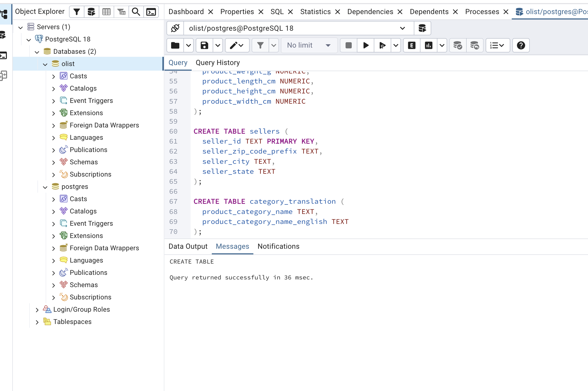

### 2. Data quality assessment: [`03_data_quality.sql`](sql/03_data_quality.sql)

| Issue found | Decision | Rationale |
|---|---|---|
| Canceled / unavailable orders present | Revenue uses `delivered` orders only | Prevents overstating sales |
| Delivered orders missing a delivery date | Excluded from delivery-time metrics | Duration cannot be computed |
| Products without a category | Labeled `unknown` | Keeps revenue complete without misattribution |
| Multiple reviews per order | Averaged to one score per order | Prevents double counting in joins |
| Partial first/last months | Excluded from growth comparisons | Avoids artificial spikes and drops |
| `customer_id` regenerated per order | Used `customer_unique_id` for customer counts | Measures real people, not transactions |

### 3. Business analysis: [`04_analysis.sql`](sql/04_analysis.sql)
Ten queries covering revenue KPIs, monthly growth (`LAG`), category and state performance,
payment mix (`SUM() OVER ()`), delivery impact on reviews, delivery time by state, repeat
rate, seller ranking (`RANK`) and purchase timing.

### 4. Reporting layer: [`05_views_for_powerbi.sql`](sql/05_views_for_powerbi.sql)
Built two views, each with an explicit grain:
- `v_order_summary`: **one row per order** (revenue, payment type, review score, delivery status)
- `v_category_sales`: **one row per item sold** (category, price, freight)

Payments and reviews are aggregated per order **before** joining. Without this, an order
with two payments and two reviews would produce four rows and inflate revenue (fan-out).

### 5. Dashboard & validation: [`powerbi/`](powerbi/)
Star-schema model: `Calendar → v_order_summary → v_category_sales`. The date table connects
to a single fact table to avoid ambiguous filter paths. DAX measures are documented in
[`dax_measures.md`](powerbi/dax_measures.md). **Dashboard KPIs reconcile exactly with SQL
results** (revenue, order count, AOV).

---

## Key Results

### KPI Overview

| Metric | Value |
|---|---|
| Delivered orders | **96,477** |
| Revenue (delivered) | **R$ 15.42M** |
| Average order value | **R$ 159.86** |
| Average review score | **4.09 / 5** |
| Late delivery rate | **≈ 8.0%** |
| Repeat-customer rate | **3.0%** (2,801 of 93,358) |

<details>
<summary>View SQL and output</summary>

```sql
SELECT COUNT(DISTINCT o.order_id) AS total_orders,
       ROUND(SUM(p.payment_value), 2) AS total_revenue,
       ROUND(SUM(p.payment_value) / COUNT(DISTINCT o.order_id), 2) AS avg_order_value
FROM orders o
JOIN payments p ON o.order_id = p.order_id
WHERE o.order_status = 'delivered';
```

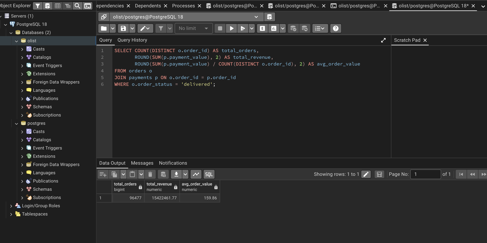
</details>

### 1. Late deliveries reduce satisfaction by ~40%

| Delivery status | Reviews | Avg. score |
|---|---|---|
| On time | 88,653 | **4.29** |
| Late | 7,700 | **2.57** |

Only ~8% of orders arrive late, but they score 1.72 stars lower on average. This is the
single strongest relationship in the data.

<details>
<summary>View SQL</summary>

```sql
WITH d AS (
  SELECT order_id,
         CASE WHEN order_delivered_customer_date > order_estimated_delivery_date
              THEN 'Late' ELSE 'On time' END AS delivery_status
  FROM orders
  WHERE order_status = 'delivered'
    AND order_delivered_customer_date IS NOT NULL
)
SELECT d.delivery_status,
       COUNT(*) AS reviews,
       ROUND(AVG(r.review_score), 2) AS avg_review
FROM d
JOIN reviews r ON r.order_id = d.order_id
GROUP BY 1;
```

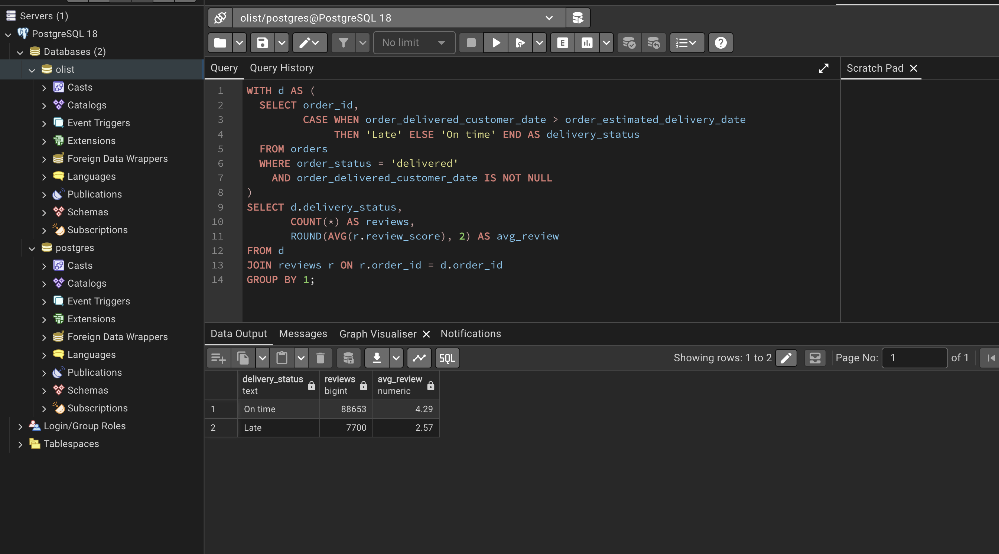
</details>

### 2. Customer retention is very low
Only **3.0%** of customers placed more than one delivered order. Almost all revenue comes
from first-time buyers, which makes acquisition costly and leaves retention largely untapped.

<details>
<summary>View SQL</summary>

```sql
WITH per_customer AS (
  SELECT c.customer_unique_id, COUNT(DISTINCT o.order_id) AS n_orders
  FROM orders o
  JOIN customers c ON c.customer_id = o.customer_id
  WHERE o.order_status = 'delivered'
  GROUP BY 1
)
SELECT COUNT(*) AS total_customers,
       SUM(CASE WHEN n_orders > 1 THEN 1 ELSE 0 END) AS repeat_customers,
       ROUND(100.0 * SUM(CASE WHEN n_orders > 1 THEN 1 ELSE 0 END) / COUNT(*), 2) AS repeat_pct
FROM per_customer;
```

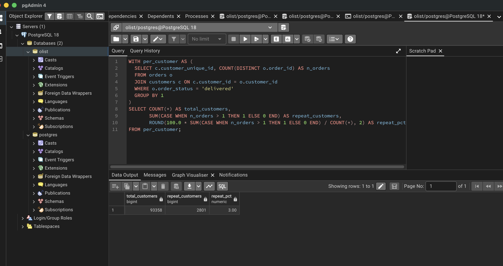
</details>

### 3. Revenue grew ~5× during 2017
Monthly revenue rose from **R$ 127.5K (Jan 2017)** to **R$ 646.0K (Aug 2017)**. 2016 data is
sparse (e.g., R$ 19.62 in Dec 2016), so growth analysis starts in 2017.

<details>
<summary>View SQL</summary>

```sql
WITH monthly AS (
  SELECT DATE_TRUNC('month', o.order_purchase_timestamp)::date AS month,
         SUM(p.payment_value) AS revenue
  FROM orders o
  JOIN payments p ON o.order_id = p.order_id
  WHERE o.order_status = 'delivered'
  GROUP BY 1
)
SELECT month,
       ROUND(revenue, 2) AS revenue,
       ROUND(100 * (revenue - LAG(revenue) OVER (ORDER BY month))
             / LAG(revenue) OVER (ORDER BY month), 1) AS growth_pct
FROM monthly
ORDER BY month;
```

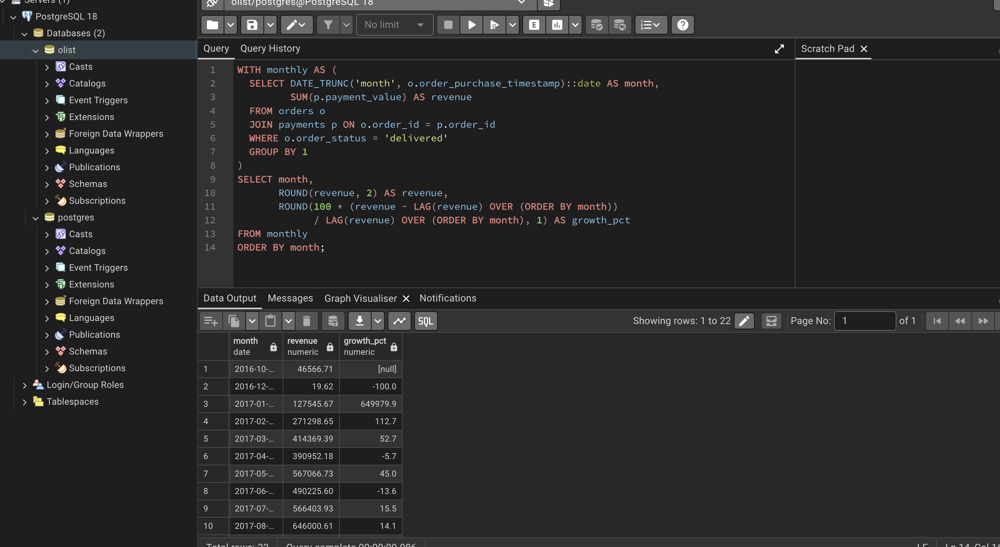
</details>

### 4. Three categories generate R$ 3.42M, each with a different model

| Category | Orders | Revenue | Revenue / order |
|---|---|---|---|
| health_beauty | 8,647 | R$ 1,233,132 | R$ 143 |
| watches_gifts | 5,495 | R$ 1,166,177 | **R$ 212** |
| bed_bath_table | **9,272** | R$ 1,023,435 | R$ 110 |

bed_bath_table wins on **volume**. watches_gifts wins on **order value**.

<details>
<summary>View SQL and output</summary>

```sql
SELECT COALESCE(t.product_category_name_english, 'unknown') AS category,
       COUNT(DISTINCT oi.order_id) AS orders,
       ROUND(SUM(oi.price), 2) AS revenue
FROM order_items oi
JOIN orders o ON o.order_id = oi.order_id
JOIN products pr ON pr.product_id = oi.product_id
LEFT JOIN category_translation t ON t.product_category_name = pr.product_category_name
WHERE o.order_status = 'delivered'
GROUP BY 1
ORDER BY revenue DESC
LIMIT 10;
```

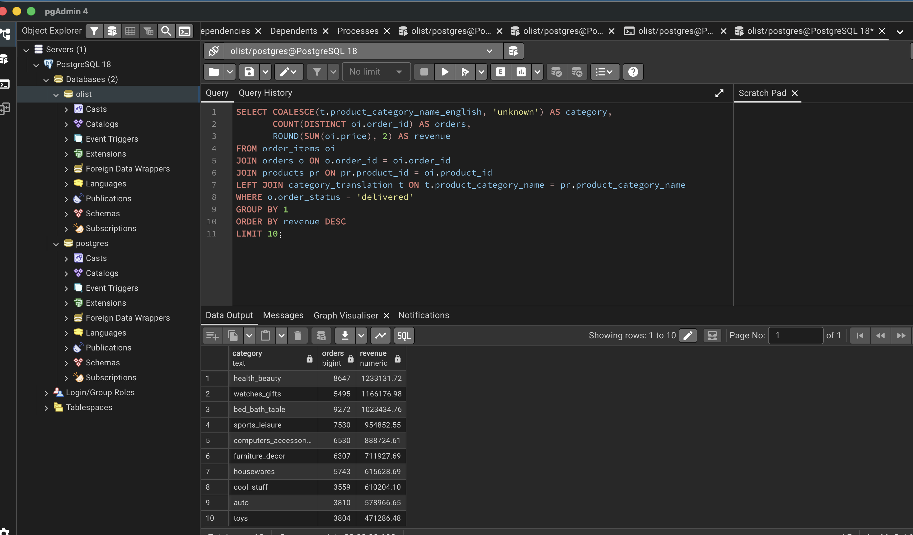
</details>

### 5. Credit card dominates, and demand peaks on weekday afternoons

| Payment type | Share |
|---|---|
| Credit card | **73.9%** |
| Boleto (bank slip) | 19.0% |
| Voucher | 5.6% |
| Debit card | 1.5% |

The busiest slot is **Tuesday at 2 PM** (1,124 orders). Monday–Tuesday between 11 AM and 4 PM
dominates the top 10 time slots, with a secondary peak on **Monday at 9 PM**.

<details>
<summary>View SQL and output</summary>

```sql
-- Payment mix
SELECT payment_type,
       COUNT(*) AS payments,
       ROUND(100.0 * COUNT(*) / SUM(COUNT(*)) OVER (), 1) AS pct
FROM payments
GROUP BY 1
ORDER BY payments DESC;
```

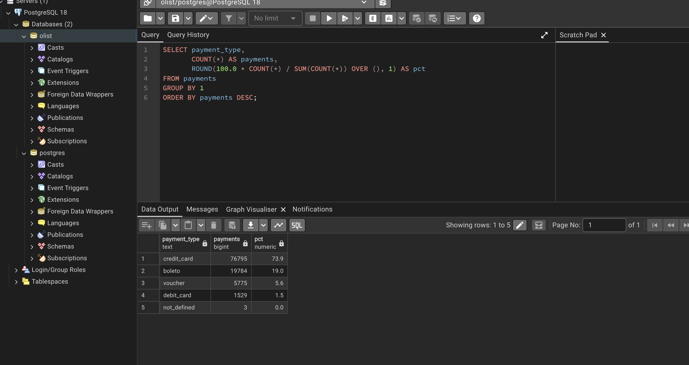

```sql
-- Busiest weekday + hour
SELECT TO_CHAR(order_purchase_timestamp, 'Day') AS weekday,
       EXTRACT(HOUR FROM order_purchase_timestamp)::int AS hour,
       COUNT(*) AS orders
FROM orders
GROUP BY 1, 2
ORDER BY orders DESC
LIMIT 10;
```

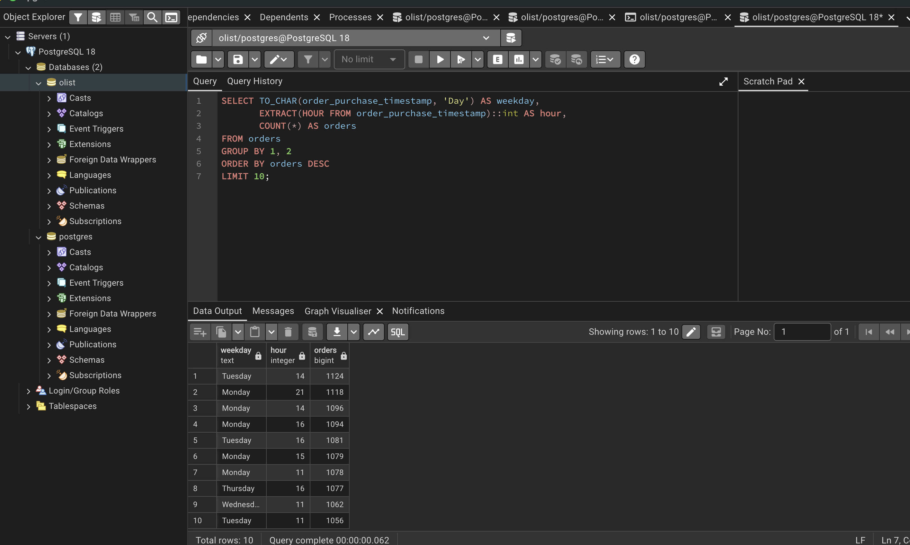
</details>

---

## Recommendations

| Priority | Recommendation | Expected impact |
|---|---|---|
| **High** | Improve logistics in the slowest-delivery states, and set more realistic delivery estimates | Higher review scores, fewer complaints |
| **High** | Launch a second-purchase program: next-order discount, loyalty points, post-delivery email | Lift the 3% repeat rate and customer lifetime value |
| Medium | Volume promotions for bed_bath_table; premium positioning for watches_gifts | Category-specific revenue growth |
| Medium | Schedule campaigns for Mon–Tue afternoons and Monday evenings | Better marketing ROI |
| Low | Keep credit-card checkout fast; keep boleto available | Protect conversion |

---

## Dashboard

The Power BI report ([`olist_dashboard.pbix`](powerbi/olist_dashboard.pbix)) has two pages:

- **Sales Overview:** KPI cards, monthly revenue trend, top 10 categories, revenue by state, with year and state slicers
- **Customer Experience:** late-delivery rate, review score by delivery status, delivery days by state, payment mix


---

## Limitations

- The delivery–review relationship is **correlational**. A controlled test would be needed to confirm causation.
- Data ends in 2018, and edge months are incomplete.
- Revenue is based on payment value, which includes freight. Category revenue uses item price only, so the two totals differ by design.
